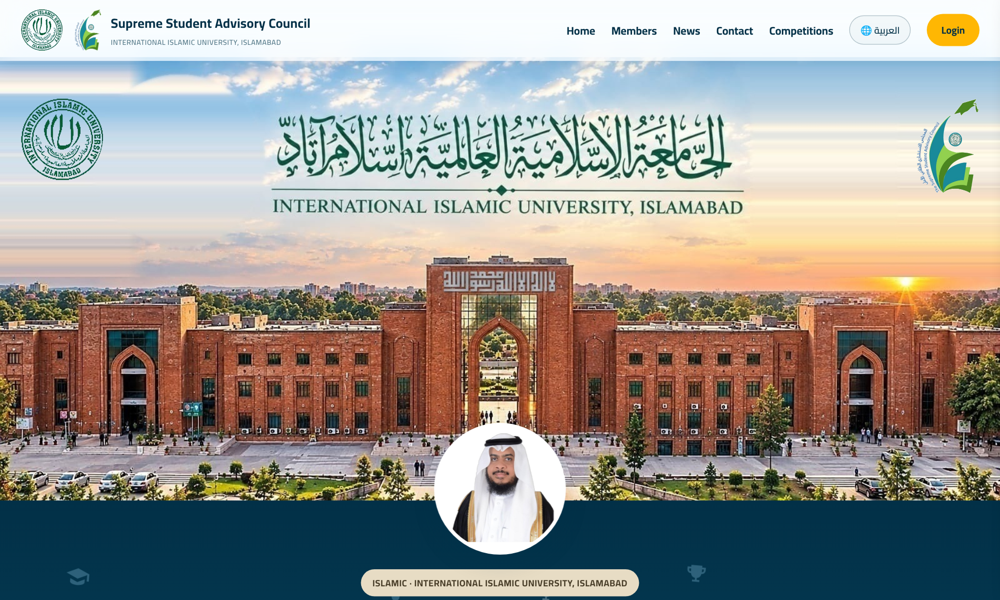
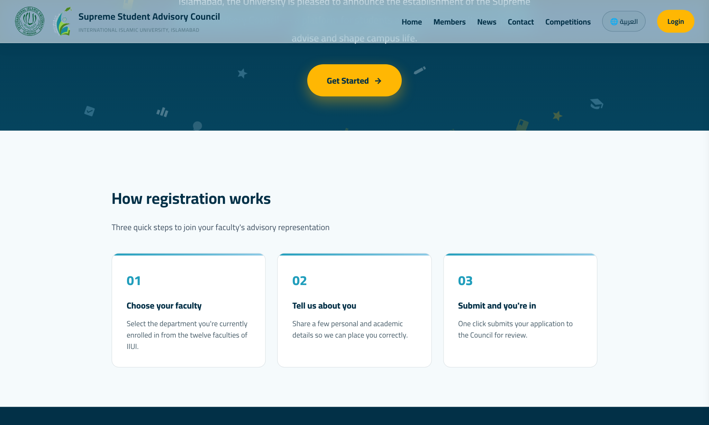
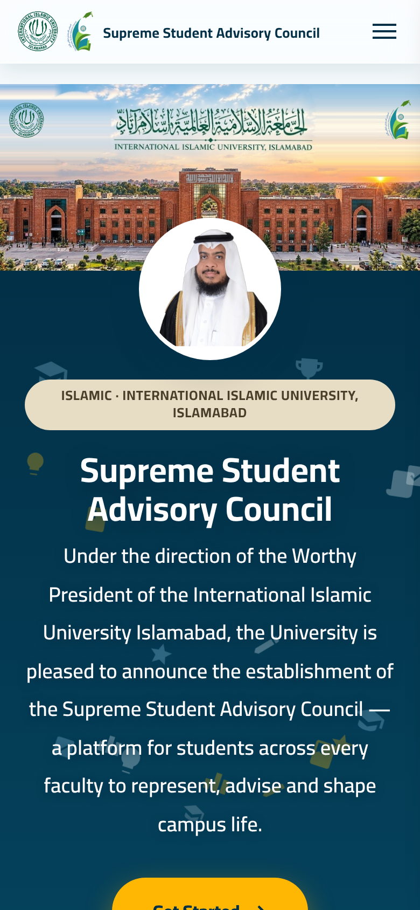

# Supreme Student Advisory Council

### International Islamic University, Islamabad (IIUI)

**A modern, fully bilingual (English · العربية) platform for student
registration, council representation, and campus competitions.**

 

### [Visit the Live Website](https://supreme-student-advisory-council.netlify.app/)

 

-FB8500?style=flat-square)

 

  

 

---

## Overview

The Supreme Student Advisory Council website is the official online home of the
Council at IIUI. It gives students a single, welcoming place to learn about the
Council, register to join, and take part in competitions and activities.

The entire experience is **bilingual** — one click switches the whole site
between **English** and **Arabic (العربية)** with full right-to-left (RTL)
layout — and it is designed to work seamlessly across phones, tablets, and
desktops.

---

## Features

| Feature | Description |
|---------|-------------|
| **Bilingual experience** | Instant English / Arabic switching with complete RTL support. |
| **Student registration** | A clean, guided sign-up to join the Council. |
| **Competitions & events** | Browse open competitions and register online. |
| **Council & members** | Learn about the Council, its roles, and its members. |
| **Role-based access** | Three distinct access levels — Admin, Council, and Student — enforced on the server. |
| **Secure admin area** | A protected dashboard to manage users, competitions, and registrations. |
| **Fully responsive** | A polished experience across every screen size. |

---

## Roles & Access

The platform has **three access levels**, each unlocking a different part of the
site. Access is enforced on the server (every API request is checked), so it
cannot be bypassed by editing the page or calling the API directly.

| Role | Access level | Can do |
|:----:|:------------:|--------|
| **Admin** | Full control | Manage users, manage competitions (create · edit · open · close), view all registrations, and reach every page. |
| **Council** | Advisory Council + Competitions | View Advisory Council content and browse / register for competitions. |
| **Student** | Competitions only | View the competitions the Admin has opened and register for them. |

> The Admin creates every account (name · email · password · role). There is no
> self-signup — only the Admin can create, edit, enable/disable, or delete users.

Full setup and API details are in **[RBAC_SETUP.md](RBAC_SETUP.md)**.

---

## A Look Inside

**Simple, three-step registration**

  

 

**Responsive mobile layout**

  

---

## Built With

| Layer | Technologies |
|-------|--------------|
| **Front-end** | HTML5 · CSS3 · JavaScript · bilingual & RTL-aware UI |
| **Back-end** | Node.js · serverless functions (Netlify / Vercel) |
| **Auth & access** | JWT sessions · server-enforced role-based access control |
| **Database** | PostgreSQL |
| **Hosting** | Netlify |

---

## Visual Identity

| Navy | Teal | Sky | Amber | Orange | Paper |
|:----:|:----:|:---:|:-----:|:------:|:-----:|
|  |  |  |  |  |  |
| `#023047` | `#219EBC` | `#8ECAE6` | `#FFB703` | `#FB8500` | `#F5FAFC` |

---

[Visit the live website](https://supreme-student-advisory-council.netlify.app/)

 

Designed & developed for the **Supreme Student Advisory Council**
International Islamic University, Islamabad

